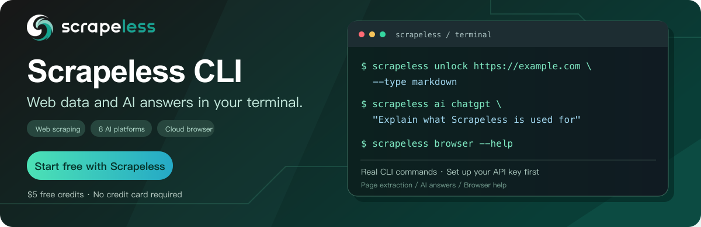

<p align="center">
  <a href="https://app.scrapeless.com/passport/register?utm_source=github&amp;utm_medium=referral&amp;utm_campaign=scrapeless-cli&amp;utm_content=repository-readme">
    
  </a>
</p>

# Scrapeless CLI

Unified CLI for Scrapeless Web Unlocker, Crawl, AI Scraper, proxy URL generation, and cloud browser automation.

**[$5 free credits · No credit card required → Sign up](https://app.scrapeless.com/passport/register?utm_source=github&utm_medium=referral&utm_campaign=scrapeless-cli&utm_content=repository-readme)**

<p align="center">
  <a href="https://app.scrapeless.com/passport/register?utm_source=github&amp;utm_medium=referral&amp;utm_campaign=scrapeless-cli&amp;utm_content=repository-readme"></a>
  <a href="https://www.scrapeless.com/en/blog?utm_source=github&amp;utm_medium=referral&amp;utm_campaign=scrapeless-cli&amp;utm_content=repository-readme"></a>
  <a href="https://x.com/Scrapelessteam?utm_source=github&amp;utm_medium=referral&amp;utm_campaign=scrapeless-cli&amp;utm_content=repository-readme"></a>
  <a href="https://www.linkedin.com/company/scrapeless/?utm_source=github&amp;utm_medium=referral&amp;utm_campaign=scrapeless-cli&amp;utm_content=repository-readme"></a>
</p>

Scrape a single page, create a crawl task, or get Markdown answers from AI platforms. HTTP commands support file output and full JSON responses.

- **Documentation:** [CLI overview](https://docs.scrapeless.com/en/docs/developer-tools/cli/overview/?utm_source=github&utm_medium=referral&utm_campaign=scrapeless-cli&utm_content=repository-readme)
- **API key:** [Scrapeless dashboard](https://app.scrapeless.com/?utm_source=github&utm_medium=referral&utm_campaign=scrapeless-cli&utm_content=repository-readme) · [Setup guide](https://docs.scrapeless.com/en/docs/get-started/get-and-protect-your-api-key/?utm_source=github&utm_medium=referral&utm_campaign=scrapeless-cli&utm_content=repository-readme)
- **Command entry point:** `scrapeless <command>` · `scrapeless --help`

A unified Scrapeless command-line tool built with TypeScript. Access Web Unlocker, Crawl, AI Scraper, proxy URL generation, and cloud browsers through a single `scrapeless` command.

| Command | Description |
| --- | --- |
| `scrapeless unlock <url>` | Scrape a single page with JavaScript rendering and multiple output formats |
| `scrapeless scrape <url>` | Alias for `unlock` |
| `scrapeless crawl <url>` | Create a crawl task and wait for results |
| `scrapeless ai <platform> "<prompt>"` | Get Markdown answers from AI platforms |
| `scrapeless proxy create` | Generate an authenticated proxy URL |
| `scrapeless browser <...>` | Automatically install and run the upstream browser CLI |
| `scrapeless config / auth` | Configure credentials and check account status |
| `scrapeless api <target>` | Reserved namespace; currently returns a not-implemented error |

## Installation

Requires Node.js 22 or later. Automatic browser installation also requires npm and access to the npm registry and GitHub Releases on first use.

```bash
npm install -g scrapeless
scrapeless --version
scrapeless --help

# Run without a global installation
npx scrapeless --help

# Install a specific version or prerelease channel
npm install -g scrapeless@0.1.0
npm install -g scrapeless@beta
```

The versions and channels in these examples must already be published to npm.

## Quick Start

Get an API token from the [Scrapeless Dashboard](https://app.scrapeless.com/?utm_source=github&utm_medium=referral&utm_campaign=scrapeless-cli&utm_content=repository-readme), then run:

```bash
scrapeless config set api_token YOUR_API_TOKEN
scrapeless auth status
scrapeless unlock https://example.com --type markdown
scrapeless crawl https://example.com --limit 10
scrapeless ai chatgpt "Explain what Scrapeless is used for"
scrapeless proxy create --gateway ap --country US
scrapeless browser --help
```

You can also use an environment variable. The CLI does not automatically load `.env` files:

```bash
export SCRAPELESS_API_KEY=YOUR_API_TOKEN
```

## Configuration and Authentication

```bash
scrapeless config set api_token YOUR_API_TOKEN
scrapeless config get apiKey
scrapeless config list
scrapeless config path
scrapeless config remove api_token
scrapeless config unset apiKey
scrapeless auth status
scrapeless auth status --json
```

`api_token`, `apiToken`, `api_key`, and `apiKey` refer to the same setting, stored as `apiKey`. Configuration is saved in `~/.scrapeless/config.json`, shared with the upstream browser's default configuration. File permissions are `0600` on Unix. Updating a setting preserves other existing settings.

Token precedence is: configuration file → `SCRAPELESS_API_TOKEN` → `SCRAPELESS_API_KEY`. This matches the upstream browser's preference for configuration values. `config get apiKey` returns the full token, while `config list` masks secret fields. By default, `auth status` only shows account status, balance, and subscription information.

| Environment Variable | Purpose |
| --- | --- |
| `SCRAPELESS_API_KEY` | API token; also supported by the browser |
| `SCRAPELESS_API_TOKEN` | Alternative token variable supported by the unified CLI |
| `SCRAPELESS_CONFIG_PATH` | Custom configuration file path for the unified CLI |
| `SCRAPELESS_CACHE_DIR` | Browser cache root; defaults to `~/.cache/scrapeless` |
| `SCRAPELESS_BROWSER_BIN` | Absolute path to a custom browser executable; skips automatic installation |
| `SCRAPELESS_API_BASE_URL` | API base URL; defaults to `https://api.scrapeless.com`; intended for development, testing, or custom gateways |

A custom configuration path only affects the unified CLI. The browser still reads the upstream default at `~/.scrapeless/config.json`. The wrapper passes the resolved token through an environment variable, but a token in the upstream configuration file takes precedence. Use the default shared configuration file to keep authentication consistent.

## Common Options and Output

HTTP commands support `--json` for the full JSON response and `-o, --output <file>` to write results to a file. Results go to stdout; task IDs, progress, and errors go to stderr for use in pipelines.

```bash
scrapeless unlock https://example.com --type markdown -o page.md
scrapeless ai chatgpt "Explain web scraping" -o answer.md
scrapeless crawl https://example.com --limit 5 --json -o crawl.json
```

Unlocker, Crawl, and AI task creation commands support `--data '<JSON>'` and `--data @request.json` for a complete API request body. Option precedence is: explicit command-line options → JSON request body → CLI defaults. Nested objects are merged; arrays are replaced as a whole. The URL or prompt can be provided directly in the JSON body, but AI commands still require a platform. Each command sets its own `actor`.

Boolean options take an explicit `true` or `false`, such as `--shopping false`. Polling options `--timeout` and `--interval` use seconds; scraping options `--wait-for` and `--scrape-timeout` use milliseconds. Place subcommand options after the subcommand, for example `ai result ID --json`.

Each HTTP request has a default timeout of 60 seconds. POST requests that create tasks are not retried automatically, to avoid duplicate tasks. Failures use exit code `1`. If task polling times out, the CLI prints the last result and task ID and exits normally; the task may still be running on the server. Browser commands preserve upstream exit codes (`130` for SIGINT and `143` for SIGTERM).

## Web Unlocker

```bash
scrapeless unlock https://example.com
scrapeless scrape https://example.com --type markdown
scrapeless unlock https://example.com --country US --js-render false
scrapeless unlock https://example.com --type content --outputs headings,links,favicon
scrapeless unlock https://example.com --type html --selector main
scrapeless unlock https://example.com --wait-until networkidle2 \
  --instructions '[{"wait":2}]' --block-resources image,font
scrapeless unlock https://example.com --type network \
  --response-options '{"methods":["GET"],"status":["200"],"urls":["api"]}'
scrapeless unlock --data @unlock.json --json
```

Defaults are actor `unlocker.webunlocker`, proxy country `ANY`, JavaScript rendering enabled, and response type `html`. By default, the CLI prints the API response's `data` field. `--json` preserves the entire response, including `code`. Image responses retain the representation returned by the API; the CLI does not automatically infer Base64 encoding or convert the data into image files.

| Option | API Field / Description |
| --- | --- |
| `--country`, `--proxy-url` | `proxy.country`, `proxy.url` |
| `--method`, `--redirect` | `input.method`, `input.redirect` |
| `--js-render`, `--headless` | `input.jsRender.enabled`, `headless` |
| `--wait-until` | `load`, `domcontentloaded`, `networkidle0`, `networkidle2` |
| `--type` | `html`, `plaintext`, `markdown`, `content`, `network`, `png`, `jpeg` |
| `--selector`, `--outputs`, `--full-page` | CSS selector, content filter list, and full-page screenshot setting in response options |
| `--response-options` | Response options as JSON; supports `methods`, `status`, `urls`, and other fields |
| `--instructions` | JSON array of JavaScript interaction instructions |
| `--cookies` | JSON array of cookies |
| `--block-resources`, `--block-urls` | Comma-separated lists of resource types and URLs |

Example complete request body in `unlock.json`:

```json
{
  "actor": "unlocker.webunlocker",
  "proxy": { "country": "US" },
  "input": {
    "url": "https://example.com",
    "method": "GET",
    "redirect": false,
    "cookies": [],
    "jsRender": {
      "enabled": true,
      "headless": true,
      "waitUntil": "domcontentloaded",
      "instructions": [{ "wait": 2 }],
      "block": { "resources": ["font"], "urls": [] },
      "response": { "type": "markdown", "options": { "selector": "main" } }
    }
  }
}
```

## Crawl

```bash
scrapeless crawl https://example.com --limit 20 --max-depth 2
scrapeless crawl https://example.com --formats markdown,html \
  --include-paths 'blog/.*,docs/.*' --exclude-paths 'private/.*' \
  --ignore-sitemap true --allow-external-links false
scrapeless crawl https://example.com --no-wait
scrapeless crawl result TASK_ID
scrapeless crawl result TASK_ID --wait --timeout 300 --interval 5
scrapeless crawl --data @crawl.json
```

After creating a task, the CLI polls every 5 seconds for up to 5 minutes by default, stopping when the status is `completed` or `failed`. Output includes the task `id`. On timeout, it returns the last status, available data, and a command to continue checking. `--no-wait` only creates the task and prints its ID.

| Option | Description |
| --- | --- |
| `--limit`, `--max-depth`, `--max-discovery-depth` | Page limit, path depth, and discovery depth |
| `--include-paths`, `--exclude-paths` | Comma-separated path patterns |
| `--ignore-sitemap`, `--ignore-query-parameters` | Ignore the sitemap or query parameters |
| `--deduplicate-similar-urls`, `--regex-on-full-url` | Deduplicate similar URLs or match regular expressions against the full URL |
| `--allow-backward-links`, `--allow-external-links` | Allow backward or external links |
| `--delay` | Delay between requests, in seconds |
| `--formats` | A combination of `markdown,html,json,links,rawHtml,screenshot,screenshot@fullPage` |
| `--only-main-content` | Extract only the main content |
| `--include-tags`, `--exclude-tags` | Lists of HTML tags |
| `--headers` | Request headers for the target page, as JSON |
| `--wait-for`, `--scrape-timeout` | Page wait time and scraping timeout, in milliseconds |
| `--scrape-options`, `--browser-options` | Complete nested options as JSON |
| `--no-wait`, `--timeout`, `--interval` | Task polling settings |

Example complete request body in `crawl.json`:

```json
{
  "url": "https://example.com",
  "limit": 50,
  "maxDepth": 3,
  "maxDiscoveryDepth": 2,
  "ignoreSitemap": false,
  "ignoreQueryParameters": true,
  "deduplicateSimilarURLs": true,
  "regexOnFullURL": false,
  "allowBackwardLinks": false,
  "allowExternalLinks": false,
  "delay": 0.5,
  "includePaths": ["docs/.*"],
  "excludePaths": ["private/.*"],
  "scrapeOptions": {
    "formats": ["markdown", "links"],
    "onlyMainContent": true,
    "includeTags": ["main"],
    "excludeTags": ["nav"],
    "headers": { "Accept-Language": "en-US" },
    "waitFor": 1000,
    "timeout": 30000
  },
  "browserOptions": {
    "sessionName": "docs-crawl",
    "sessionTTL": "300",
    "sessionRecording": "false",
    "proxyCountry": "US",
    "fingerprint": "chrome"
  }
}
```

Set a custom proxy with `browserOptions.proxyURL`. API options that are not explicitly specified use server defaults.

## AI Scraper

```bash
scrapeless ai platforms
scrapeless ai chatgpt "Recommend attractions in New York" --country US --web-search true --shopping false
scrapeless ai gemini "Explain quantum computing" --shopping false
scrapeless ai copilot "Explain quantum computing" --mode reasoning
scrapeless ai perplexity "What web scraping techniques are available?" --web-search true
scrapeless ai grok "Explain quantum computing" --mode MODEL_MODE_EXPERT
scrapeless ai alexa "Recommend attractions in New York"
scrapeless ai google-ai-mode "Restaurants in New York" --location 'New York,New York,United States'
scrapeless ai google-ai-overview "What is web scraping?" --shopping false
scrapeless ai google-ai-mode --url 'https://www.google.com/search?q=example&udm=50'
scrapeless ai chatgpt "Recommend attractions" --no-wait --webhook https://example.com/webhook
scrapeless ai result TASK_ID --platform chatgpt --wait
scrapeless ai result TASK_ID --json
```

Defaults are `country=US` and polling every 5 seconds for up to 5 minutes. On success, the CLI prints only the Markdown content by default. On failure, it prints the reason and exits with a nonzero status. On timeout, it prints the task ID and last response. Use `--json` to preserve the full response, including citations, products, and search results.

| Platform | Actor | Markdown Field | Platform-Specific Options |
| --- | --- | --- | --- |
| `chatgpt` | `scraper.chatgpt` | `result_text` | `--web-search`, `--shopping`, `--should-fetch-share-link` |
| `gemini` | `scraper.gemini` | `result_text` | `--shopping` |
| `copilot` | `scraper.copilot` | `result_text` | `--mode`, `--should-fetch-share-link` |
| `perplexity` | `scraper.perplexity` | `result_text` | `--web-search`, `--should-fetch-share-link` |
| `grok` | `scraper.grok` | `full_response` | `--mode`, `--should-fetch-share-link` |
| `alexa` | `scraper.alexa` | `md_text` | None |
| `google-ai-mode` (alias: `aimode`) | `scraper.aimode` | `result_md` | `--shopping`, `--location`, `--uule`, `--url`, `--should-fetch-share-link` |
| `google-ai-overview` (alias: `overview`) | `scraper.overview` | `content` | `--shopping`, `--location`, `--uule`, `--should-fetch-share-link` |

All platforms support `--country`, `--webhook`, `--data`, output options, and polling options. The CLI does not override server defaults for shopping or search. Refer to the relevant service documentation for shopping data billing rules.

Copilot defaults to `search` and also supports `smart`, `chat`, `reasoning`, and `study`. Grok defaults to `MODEL_MODE_AUTO` and also supports `MODEL_MODE_FAST` and `MODEL_MODE_EXPERT`.

`location` and `uule` are mutually exclusive. Google AI Mode requests that use `url` send only `url`, ignoring all other input options. If Google AI Overview does not trigger an overview, an empty `content` field is still a valid result. When no platform is specified for `ai result`, the CLI checks each of the documented Markdown fields.

Example of a more complex AI request:

```bash
scrapeless ai chatgpt --data '{"input":{"prompt":"Recommend attractions in New York","country":"JP","web_search":true,"shopping":false,"should_fetch_share_link":true},"webhook":{"url":"https://example.com/webhook"}}'
```

## Proxies

Proxy commands build authenticated URLs locally without making HTTP requests.

```bash
scrapeless proxy gateways
scrapeless proxy create --country US --gateway us
scrapeless proxy create --type residential --country US --state AL --city foley \
  --session-duration 10 --session-id sid --gateway ap
scrapeless proxy create --type ipv6 --country JP --gateway gw-ap.scrapeless.io:8789
scrapeless proxy create --type datacenter --country DE --gateway eu --json
```

Defaults are type `residential`, country `US`, a 10-minute session, an automatically generated session ID, and the Americas gateway. `--gateway` accepts `us`, `eu`, `ap`, or `hostname:port`. Country, state, city, and session ID values must be alphanumeric. Use city codes supported by the server.

| Region | Gateway |
| --- | --- |
| Americas | `gw-us.scrapeless.io:8789` |
| Europe | `gw-eu.scrapeless.io:8789` |
| Asia | `gw-ap.scrapeless.io:8789` |

The output has the following format. Special characters in the token are URL-encoded. The URL contains the full credentials:

```text
http://CHANNEL-proxy.residential-country_US-state_AL-city_foley-r_10m-s_sid:TOKEN@gw-ap.scrapeless.io:8789
```

## Browser

```bash
scrapeless browser --help
scrapeless browser --version
scrapeless browser new-session --name demo --ttl 300 --json
scrapeless browser --session-id TASK_ID open https://example.com
scrapeless browser --session-id TASK_ID snapshot -i
scrapeless browser --session-id TASK_ID click @e1
scrapeless browser --session-id TASK_ID fill @e2 "hello world"
scrapeless browser --session-id TASK_ID screenshot page.png
scrapeless browser --session-id TASK_ID close
```

All arguments after `browser`, including `--help`, `--version`, and `--`, are forwarded to the upstream CLI, along with standard input/output and exit codes. Arguments are passed directly without shell parsing.

The upstream repository is [scrapeless-ai/scrapeless-agent-browser](https://github.com/scrapeless-ai/scrapeless-agent-browser?utm_source=github&utm_medium=referral&utm_campaign=scrapeless-cli&utm_content=repository-readme). The verified npm package and command name for v0.1.1 is **`scrapeless-scraping-browser`**. The wrapper uses this published package and its binaries; `scrapeless-agent-browser` is the repository name, not the npm package name used by this wrapper.

On first use, including `--help`, the CLI:

1. Selects the pinned v0.1.1 release for the operating system and CPU architecture.
2. Installs the npm package and Node.js daemon dependencies into a temporary cache directory, skipping installation scripts to avoid modifying global commands.
3. Verifies the packaged binary. If it is missing or does not match, downloads it from GitHub Releases and verifies it against the built-in SHA-256 checksum.
4. Atomically moves the complete installation to `~/.cache/scrapeless/browser/0.1.1-<platform>-<arch>/`.
5. Runs the cached binary. Subsequent calls reuse the cache without reinstalling.

Supported platforms are macOS x64/arm64, Linux x64/arm64, and Windows x64. The pinned upstream release has no Windows arm64 artifact, so that platform returns an explicit error. Use `SCRAPELESS_BROWSER_BIN` to supply a compatible executable with its required runtime.

To upgrade upstream, maintainers update the pinned version and checksums in `src/browser.ts`. Each version has a separate cache. Failed installations clean up their temporary directory, allowing you to retry the command. If an existing cache is damaged, the error identifies the directory to move aside. No separate Chromium installation is needed: browser sessions run in the Scrapeless cloud.

```bash
# Use an upstream executable you installed or built yourself
export SCRAPELESS_BROWSER_BIN=/absolute/path/to/scrapeless-agent-browser
scrapeless browser --help
```

A custom entry point must be directly executable (`.exe` on Windows). The wrapper does not run `.cmd` files through a shell. For all proxy, session, and page operation options, run `scrapeless browser --help` or consult the upstream README.

## Development and Testing

```bash
corepack enable
pnpm install --frozen-lockfile
pnpm dev --help
pnpm typecheck
pnpm test
pnpm build
pnpm check
node dist/cli.js --help
npm pack --dry-run --ignore-scripts
```

Tests use the Node.js test runner and locally mocked responses. They require no real API token and do not call paid APIs. Coverage includes request construction, all 8 AI platforms, authentication, task polling, timeouts, failures, file output, proxy URLs, browser installation/caching/integrity/argument forwarding, and release version mapping.

`.github/workflows/ci.yml` runs type checking, tests, builds, and npm package checks on Linux, macOS, and Windows with Node.js 22 and 24.

Project layout:

```text
src/                  TypeScript CLI, commands, and shared modules
test/                 Automated tests
scripts/release.mjs   Sets package.json version and npm dist-tag from the Git tag
.github/workflows/    CI and npm publishing
dist/                 Build output generated by the compiler
requirement_1.md       Original requirements
*.mdx                 API references for AI platforms
```

## Automatic npm Publishing with Git Tags

Pushing a version tag triggers `.github/workflows/publish.yml` to install dependencies, set the version, run checks, package the build, and publish `scrapeless`.

| Git Tag | npm Version | npm Dist-Tag |
| --- | --- | --- |
| `v1.2.3` or `1.2.3` | `1.2.3` | `latest` |
| `v1.3.0-beta.1` | `1.3.0-beta.1` | `beta` |
| `v1.3.0-rc.1` | `1.3.0-rc.1` | `rc` |
| `v1.3.0-0` | `1.3.0-0` | `next` |

The version is derived from the tag. CI updates `package.json` in its working directory before building, so no manual version change is required and no commit is written back to the repository. Prereleases do not replace `latest`. Tags must use strict SemVer; build metadata (`+build`) and incomplete versions are rejected.

Publishing uses the following GitHub Actions credentials:

- **`GITHUB_TOKEN`**: Automatically provided by GitHub to check out the repository, with `contents: read` permissions.
- **`NPM_TOKEN`**: A repository or organization Actions secret, passed to the publishing step through `NODE_AUTH_TOKEN`. The token must have permission to publish the npm package `scrapeless`. Organization secrets must be made available to this repository.

This workflow is triggered by version tags and publishes directly with an npm token, so Trusted Publisher configuration is not required. It does not write commits or push tags back to the repository, so `DEPLOY_SSH_KEY` is not needed. It uses Node.js 24 to satisfy the project's Node.js 22+ requirement. The pnpm version is pinned by `package.json.packageManager`. The package name is the unscoped `scrapeless`, so no `@scrapeless-ai` scope is required. Once a version is published to npm, it cannot be overwritten.

```bash
# Commit and push the implementation before pushing a version tag
git tag v0.1.0
git push origin v0.1.0

# Publish a prerelease
git tag v0.2.0-beta.1
git push origin v0.2.0-beta.1
```

## Troubleshooting

- **Missing API token**: Set `SCRAPELESS_API_KEY` or run `config set api_token`. Check whether the configuration file still contains an old token.
- **HTTP 401/403**: Check the token, account permissions, and balance. Use `auth status` to verify authentication.
- **Task timeout**: The task may still be running on the server. Use the returned ID with `crawl result` or `ai result`, adding `--wait` to continue waiting.
- **Automatic browser installation fails**: Confirm that Node.js and npm are available, the cache directory is writable, and npm and GitHub are reachable, then retry. Downloads that fail SHA-256 verification are not executed.
- **Upstream browser session errors**: Specify `--session-id` explicitly and check whether the session has expired. Session behavior is determined by the pinned upstream version.

## Related projects

| **Project** | **Purpose** |
| :--- | :--- |
| [Node.js SDK](https://github.com/scrapeless-ai/sdk-node?utm_source=github&utm_medium=referral&utm_campaign=scrapeless-cli&utm_content=repository-readme) · [Python SDK](https://github.com/scrapeless-ai/sdk-python?utm_source=github&utm_medium=referral&utm_campaign=scrapeless-cli&utm_content=repository-readme) · [Go SDK](https://github.com/scrapeless-ai/sdk-go?utm_source=github&utm_medium=referral&utm_campaign=scrapeless-cli&utm_content=repository-readme) | Integrate Scrapeless into application code |
| [Scrapeless MCP Server](https://github.com/scrapeless-ai/scrapeless-mcp-server?utm_source=github&utm_medium=referral&utm_campaign=scrapeless-cli&utm_content=repository-readme) | Access Scrapeless from MCP-compatible AI clients |
| [Scrapeless Agent Browser](https://github.com/scrapeless-ai/scrapeless-agent-browser?utm_source=github&utm_medium=referral&utm_campaign=scrapeless-cli&utm_content=repository-readme) | Upstream CLI used by `scrapeless browser` |
| [Scrapeless Respondo](https://github.com/scrapeless-ai/respondo?utm_source=github&utm_medium=referral&utm_campaign=scrapeless-cli&utm_content=repository-readme) | Extract and transform saved HTML and JSON locally |
| [Amazon Scraper](https://github.com/scrapeless-ai/amazon-scraper?utm_source=github&utm_medium=referral&utm_campaign=scrapeless-cli&utm_content=repository-readme) | Amazon product, seller, search, and Rufus API examples |

Related projects have their own installation and usage instructions.

## Learn more

[Web Unlocker](https://docs.scrapeless.com/en/docs/web-unlocker/introduction/?utm_source=github&utm_medium=referral&utm_campaign=scrapeless-cli&utm_content=repository-readme) · [Crawl](https://docs.scrapeless.com/en/docs/browser-crawl/crawl/introduction/?utm_source=github&utm_medium=referral&utm_campaign=scrapeless-cli&utm_content=repository-readme) · [AI Scraper](https://docs.scrapeless.com/en/docs/ai-scraper/quickstart/introduction/?utm_source=github&utm_medium=referral&utm_campaign=scrapeless-cli&utm_content=repository-readme) · [Agent Browser](https://docs.scrapeless.com/en/docs/browser-crawl/agent-browser/introduction/?utm_source=github&utm_medium=referral&utm_campaign=scrapeless-cli&utm_content=repository-readme) · [Proxies](https://docs.scrapeless.com/en/docs/proxies/introduction/?utm_source=github&utm_medium=referral&utm_campaign=scrapeless-cli&utm_content=repository-readme)

[SDKs](https://docs.scrapeless.com/en/docs/developer-tools/sdks/overview/?utm_source=github&utm_medium=referral&utm_campaign=scrapeless-cli&utm_content=repository-readme) · [MCP](https://docs.scrapeless.com/en/docs/developer-tools/scrapeless-mcp/overview/?utm_source=github&utm_medium=referral&utm_campaign=scrapeless-cli&utm_content=repository-readme) · [Blog](https://www.scrapeless.com/en/blog?utm_source=github&utm_medium=referral&utm_campaign=scrapeless-cli&utm_content=repository-readme)

## Contact us

Report CLI bugs or request features through [GitHub Issues](https://github.com/scrapeless-ai/scrapeless-cli/issues?utm_source=github&utm_medium=referral&utm_campaign=scrapeless-cli&utm_content=repository-readme). For product questions, join [Discord](https://discord.gg/VU2vtbq7Q2?utm_source=github&utm_medium=referral&utm_campaign=scrapeless-cli&utm_content=repository-readme) or contact us on [Telegram](https://t.me/scrapeless?utm_source=github&utm_medium=referral&utm_campaign=scrapeless-cli&utm_content=repository-readme). Never include API keys in public reports.
